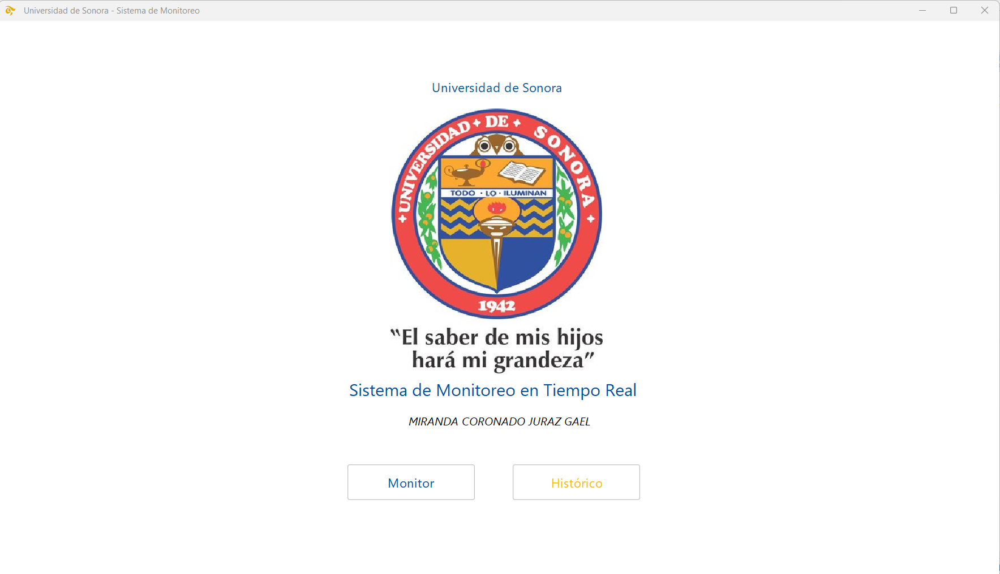
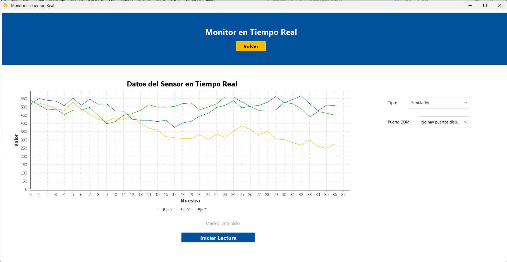
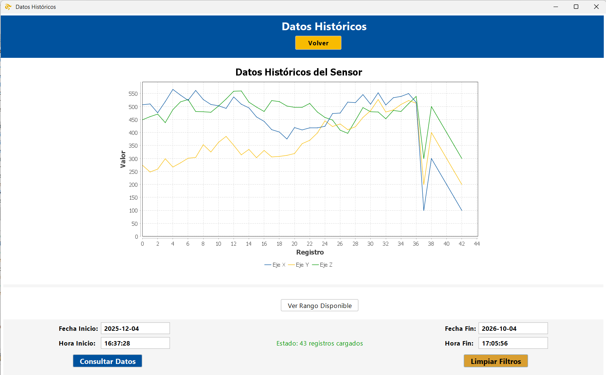

# ClienteMonitor: monitoreo en tiempo real con Arduino, sockets y encriptación (Java)

Aplicación de escritorio en Java que monitorea en tiempo real un sensor de tres ejes conectado a un Arduino. El cliente lee los valores x, y, z por puerto serial, los encripta con AES-256 y los envía por sockets a un servidor multihilo. El servidor los desencripta y los guarda en una base de datos SQLite. Una vista de monitor muestra los datos en vivo y una vista de histórico permite consultarlos con filtros por fecha y hora. Incluye un simulador de Arduino para probar el sistema sin hardware.

## Tecnologías

Java 17 · Maven · Swing + FlatLaf · jSerialComm (puerto serial) · JFreeChart (gráficas) · Sockets TCP · AES-256 (CBC) · SQLite (JDBC) · org.json

## Cómo funciona

    Arduino → LectorArduino → Encriptacion (AES-256) → ConexionServidor
                                                              │ sockets (puerto 5000)
                                                              ▼
                         VistaHistorico ← consulta ← Servidor → BaseDatos (SQLite)

- **Arduino:** envía por serial, a 9600 baudios, líneas con el formato `x:###, y:###, z:###`.
- **Cliente:** `LectorArduino` lee el puerto, `Encriptacion` cifra los datos y `ConexionServidor` los manda al servidor.
- **Servidor:** atiende a cada cliente en su propio hilo, desencripta, guarda en SQLite y responde las consultas del histórico, también encriptadas.
- **Protocolo:** el cliente manda `DATOS:<texto encriptado>` para guardar y `CONSULTA:fechaInicio|fechaFin|horaInicio|horaFin` para consultar.

## Cómo ejecutarlo

1. Clona el repositorio y compílalo con `mvn compile`.
2. Ejecuta primero el servidor: `mx.unison.clientemonitor.servidor.Servidor`. Al iniciar crea la base de datos `monitorBD.db`.
3. Ejecuta el cliente: `mx.unison.clientemonitor.VentanaPrincipal`.
4. En **Monitor**, elige el tipo de fuente (**Simulador** o **Arduino Físico**, con su puerto COM) y presiona **Iniciar Lectura**.
5. En **Histórico**, filtra por fecha (`yyyy-MM-dd`) y hora (`HH:mm:ss`), o usa **Ver Rango Disponible** para autocompletar los filtros.

El simulador permite probar todo el sistema sin tener el Arduino conectado.

## Imágenes

